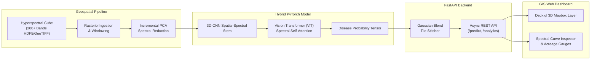

# TerraSpectra: Hyperspectral Crop Disease Forecasting

[](https://www.python.org/downloads/)
[](https://pytorch.org/)
[](https://fastapi.tiangolo.com/)
[](https://react.dev/)
[.svg)](https://deck.gl/)
[](https://opensource.org/licenses/MIT)

> **TerraSpectra** is an enterprise-grade precision agriculture intelligence platform designed to forecast fungal crop disease outbreaks up to **three weeks before visible symptoms appear** on foliage. By ingesting 200+ band hyperspectral satellite data cubes and applying a hybrid **3D-CNN + Vision Transformer (ViT)** neural network, TerraSpectra captures subtle pre-symptomatic shifts in chlorophyll reflectance and red-edge absorption across 1,000+ acre agricultural terrains.

---

## 🌾 Problem & Domain Context

Traditional satellite crop monitoring relies on standard 3-band RGB or basic multispectral infrared imagery (e.g., standard NDVI). These approaches detect anomalies only after leaf tissues turn yellow or brown (chlorosis and necrosis)—which is often too late to prevent widespread harvest destruction.

Furthermore, standard 2D Convolutional Neural Networks (CNNs) treat multi-band imagery as flat channels, failing to capture the continuous physical and chemical spectral depth necessary for early pathogen detection.

**TerraSpectra solves this through:**
1. **Hyperspectral Depth**: Ingestion of 200+ narrow, contiguous spectral bands (400 nm to 2400 nm).
2. **Hybrid 3D-CNN + ViT**: 3D convolutions capture simultaneous spatial and spectral features; self-attention heads model non-local spectral band correlations.
3. **High-Throughput Tiling Engine**: Slices multi-gigabyte satellite rasters into inference chunks and seamlessly re-stitches them using Gaussian overlap blending.
4. **Interactive 3D GIS Dashboard**: Deck.gl-powered 3D visualization rendering disease risk heatmaps, historical temporal progression, and interactive 200-band spectral profile inspection.

---

## 🏛 System Architecture



---

## 🛠 Technology Stack

| Layer | Technology | Purpose |
|---|---|---|
| **Geospatial Pipeline** | Python, Rasterio, GDAL, NumPy | Windowed ingestion of 200-band cubes, affine projection, metadata parsing |
| **Spectral Reduction** | Scikit-learn (IncrementalPCA) | Dimensionality reduction across 200+ continuous spectral bands |
| **Deep Learning** | PyTorch, torchvision | Hybrid 3D-CNN + ViT model, Focal Loss, spectral self-attention |
| **Inference Server** | FastAPI, Uvicorn, Pydantic | Asynchronous REST API, GPU memory recycling, sliding window tiling |
| **GIS & 3D Visualization** | React, Deck.gl, Mapbox GL JS | 3D terrain overlay, sub-meter farm parcel georeferencing, custom shaders |
| **Analytics & UI** | Tailwind CSS, Lucide Icons, Recharts | Interactive spectral reflectance curve inspector, risk gauges, timeline scrubbing |

---

## 📂 Project Structure

```text
terraspectra/
├── backend/
│   ├── app/
│   │   ├── api/          # FastAPI routes, schemas, endpoints
│   │   ├── core/         # App configuration, logging, settings
│   │   ├── models/       # PyTorch 3D-CNN + ViT architectures, loss functions
│   │   ├── pipeline/     # Rasterio ingestion, PCA reducer, tiling engine
│   │   ├── utils/        # Hyperspectral cube simulator, geo-transforms
│   │   └── main.py       # FastAPI application entrypoint
│   ├── tests/            # Test suites and mid-project review audits
│   └── requirements.txt  # Python backend dependencies
├── frontend/
│   ├── src/
│   │   ├── components/   # MapView (Deck.gl), AnalyticsPanel, TimelineSlider
│   │   ├── services/     # Axios API client
│   │   ├── App.jsx       # Root layout and state management
│   │   └── main.jsx      # React DOM entrypoint
│   ├── package.json      # Node.js dependencies
│   ├── tailwind.config.js
│   └── vite.config.js
└── README.md
```

---

## 🚀 Quickstart Guide

### 1. Backend Setup
```bash
cd backend
python -m venv venv
# Windows:
.\venv\Scripts\activate
# Linux/macOS:
source venv/bin/activate

pip install -r requirements.txt
uvicorn app.main:app --reload --port 8000
```
- API Documentation: `http://localhost:8000/docs`
- Health check: `http://localhost:8000/health`

### 2. Frontend Setup
```bash
cd frontend
npm install
npm run dev
```
- Dashboard runs at `http://localhost:5173`

---

## 📅 4-Week Development Roadmap

- **Week 1**: Data Pipeline (Rasterio, 200-band cube generator, Incremental PCA) & React + Deck.gl scaffolding.
- **Week 2**: PyTorch 3D-CNN model architecture, focal loss training, Deck.gl heatmap layers, & **Mid-Project Review Audit** (memory profiling & GIS coordinate validation).
- **Week 3**: Vision Transformer (ViT) spectral self-attention integration, hybrid model benchmarking, & interactive analytics dashboard.
- **Week 4**: High-throughput FastAPI deployment, raster tiling & stitching engine, temporal progression slider, and **Final Review**.
